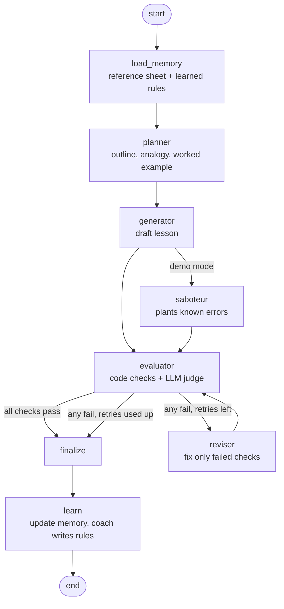

# Architecture & Design Reasoning

## 1. The problem, restated

Generating a lesson is easy. The hard part is **deciding, without a human, whether the lesson is good enough
to ship** to a learner who:

- has finished 12th grade in India and studied in a non-English-medium school,
- has limited English vocabulary,
- starts from zero in AI.

For this learner, "good" means three things: correct, understandable, and complete. So the system is built
around an **evaluator you can trust**. Generation is the easy part.

## 2. The loop

Implemented as a LangGraph `StateGraph` (`src/lessonforge/graph.py`). Run `lessonforge graph` to print the
compiled graph.

| Node | Job | Why it exists |
|---|---|---|
| `load_memory` | Loads the grounding sheet, learned rules, human feedback and learned avoid-words | Every run starts from what earlier runs learned |
| `planner` | JSON plan: goals, order of terms, analogy, worked example, quiz | Separating *what to teach* from *how to write it* gives better flow. The order of terms is planned before any text exists |
| `generator` | Writes the full lesson from the plan | One focused job: write well for this learner |
| `saboteur` | (only with `--inject-error`) plants 2 known errors | Lets us show, again and again, that the evaluator catches real mistakes |
| `evaluator` | 18 pass/fail checks | The quality gate |
| router | Ships only if **all** checks pass. Otherwise revises, or stops when the retry budget is used up | The decision belongs to code, not to a model |
| `reviser` | Fixes only the failed checks, using the judge's quoted evidence, and returns a changelog | Targeted edits do not break parts that already pass. A full rewrite often does |
| `finalize` | Picks the passing attempt. If none passed, picks the best attempt and marks it `NEEDS_HUMAN_REVIEW` | The loop always ends, and a weak lesson is never shipped silently |
| `learn` | Updates memory. The coach turns repeated failures into rules | This is the self-evolving part |

## 3. The evaluator (the most important component)

### 3.1 The rubric: 18 hard pass/fail checks across the 6 dimensions

All checks are defined in `rubric/rubric.yaml`, which is the single source of truth. A lesson ships only if
**every** check passes. There is no partial credit and no weighted score. A weighted average can hide a
serious problem: a lesson with one factual error should not ship just because its language is lovely.

| Dimension | Code checks (deterministic) | LLM checks (judgement) |
|---|---|---|
| Accurate & grounded | – | ACCURACY, GROUNDED_DEFINITION, NO_OVERCLAIM |
| Beginner-friendly language | SENTENCE_LENGTH, READABILITY, AVOID_WORDS, LENGTH | PLAIN_LANGUAGE |
| Teaches by example | – | ANALOGY, WORKED_EXAMPLE |
| Clear, no unexplained jargon | ACRONYMS, DEFINED_BEFORE_USE, GLOSSARY | JARGON |
| Covers the key points | QUIZ | COVERAGE |
| Coherent teaching flow | STRUCTURE | FLOW |

### 3.2 Why two kinds of check

- **Code checks** cover everything that can be measured: required sections in order, sentence length,
  readability, banned idioms, acronym expansion, whether a term is used before it is defined, and the
  glossary and quiz format. They cost nothing, give the same answer every time, and cannot be argued with.
- **The LLM judge** covers only what needs judgement: factual accuracy, the quality of the analogy, whether
  the worked example shows every step, and coverage.

**What we learned from a real run.** In run 2, the LLM judge passed a lesson whose "What You Will Learn"
list used *chunks, embeddings, vector database* before they were explained. My own review caught it. We
did not just reword the prompt. We added `DEFINED_BEFORE_USE`, a code check, as a backstop. **Wherever a
quality rule can be measured, we measure it in code instead of trusting a model.** The free-model gateway
also switches between models, so the judge is not always the same model. That makes code checks even more
valuable.

### 3.3 Making the LLM judge trustworthy

1. **Grounding.** The judge receives a curated reference sheet (`knowledge/rag_reference.md`) with core
   facts (F1–F14), must-cover points (K1–K7) and known misconceptions (M1–M7). "Accurate" therefore means
   "agrees with this sheet", not "agrees with the judge's own memory".
2. **Evidence is required.** Every verdict must quote the lesson, or say `MISSING: ...`.
3. **Evidence is verified.** If a FAIL quotes text that is not in the lesson, the judge invented it. That
   group of checks is then judged again. This stops false rejections without weakening real ones.
4. **Fail-closed.** If the judge gives no verdict for a check, that check counts as FAIL. A broken judge can
   never ship a lesson.
5. **Focused groups.** Grounding checks and teaching checks are judged in separate calls, so each prompt
   has one clear job.
6. **A different model for judging.** `JUDGE_MODEL` can differ from `GENERATOR_MODEL`. This reduces the
   bias of a model grading its own work.
7. **Optional majority vote.** Set `judge_votes: 3` for more stable verdicts, at 3× the judge cost.
8. **Complete feedback.** The judge must list every problem for a check, not only the first one. Otherwise
   each retry fixes one term and the next retry finds another.
9. **All checks always run.** Even if a code check fails, the LLM checks still run. The reviser then gets
   the full list of problems in one round.

### 3.4 The readability check

Flesch Reading Ease penalises long words. A RAG lesson *must* use words like "retrieval", "hallucination"
and "embedding". So we score the everyday English *around* those words: the terms listed in the lesson's
own glossary are left out of the syllable count. Whether those terms are explained is the job of JARGON
and DEFINED_BEFORE_USE. The log shows both the adjusted score and the raw score.

## 4. Regeneration strategy

- **Revise, don't regenerate from scratch.** The reviser gets the rejected lesson and each failed check
  with its reason, the quoted evidence and the fix. It also gets the list of checks that already pass and
  must stay passing.
- **Revise from the best attempt so far, not the last one.** If a revision gets worse, the next revision
  starts from the better version. Each attempt records which checks it **fixed** and which it **broke**.
- **Budget:** `max_retries: 2`, so at most 3 attempts. The loop always ends. If nothing passes, the best
  attempt is saved with a "NOT SHIPPED – needs human review" banner.

## 5. Memory & self-evolution

`memory/memory.json` is a readable JSON file that persists across runs:

| Memory | Written by | Used for |
|---|---|---|
| `runs` | `learn` | History: status and failed checks per attempt |
| `check_stats` (fails, samples of reason + evidence) | `learn` | Finding repeated failure patterns |
| `guidelines` (one per check, versioned) | coach | Added to the planner, generator and reviser prompts |
| `learned_avoid_words` | coach | Added to the AVOID_WORDS code check, so **the rubric itself gets stricter** |
| `human_feedback` | `lessonforge feedback "..."` | Added to every prompt in future runs |

**How the coach learns.** When a check has failed at least `coach_min_failures` times (counted across
runs), the coach reads the recent failure samples and writes one concrete, testable rule for the writer.
If the check keeps failing after a rule exists, the coach **sharpens** that rule (version 2, 3, ...). The
old text is kept so you can see how the rule changed.

**Safety rule.** Failures caused by the saboteur in demo mode are never written to memory. Otherwise the
system would "learn" from errors that it did not make.

**Stale-rule protection.** Each check's definition has a fingerprint (a hash of its criterion and
parameters). Every failure sample and every rule is tagged with the fingerprint that was current when it
was recorded. The coach learns only from samples under the current definition, and rules from an older
definition are left out of the prompts. This was added after a real problem: once I relaxed the JARGON
criterion, the coach kept "sharpening" a rule built from failures under the old, stricter definition.

**Safe with parallel runs.** Memory writes take a file lock, reload the latest file and then merge. Two
runs at the same time no longer overwrite each other's learning. Before this fix, a real overlap lost one
run's updates. The slow coach call happens outside the lock.

## 5.1 What happened in the real runs (all logs are in `outputs/`)

| Run | Rules in memory | Result | What I learned and changed |
|---|---|---|---|
| 1 `095251` | 0 | 11 → 13 → 14 of 16 passed. Retry budget used up, so **needs human review** | The judge reported only the first unexplained term, so each retry fixed one term and the next retry found another. **Fix:** the judge must list every problem for a check. READABILITY failed at 59.8 because of words the lesson had to use, so the score now leaves out taught terms. The coach wrote 3 rules |
| 2 `100011` | 3 | **SHIPPED** on attempt 2 (16/16) | My own review found jargon the judge missed. **Fix:** added the DEFINED_BEFORE_USE and GLOSSARY code checks, and made COVERAGE and NO_OVERCLAIM stricter |
| 3 `101430` | 5 | 15/18 best, **needs human review** | This time the evaluator had bugs: "5 PM" was treated as an acronym, and "small pieces (chunks)" was not recognised as a definition. The reviser even "fixed" PM as "Prime Minister". **Lesson: false failures waste retries and teach the coach wrong rules.** **Fix:** allow AM/PM, accept the "(term)" definition style, and let the goals list name terms |
| 4 `102840` | 6 | **SHIPPED** on attempt 2 (18/18). This is the submitted lesson | – |
| 5 `103851-inject` | 6 | Attempt 1 (with the saboteur's errors): 9/18, and both planted errors were caught by ACCURACY, NO_OVERCLAIM, AVOID_WORDS, ACRONYMS and JARGON. Attempt 2: 16/18. Attempt 3: **SHIPPED** 18/18 | The saboteur's failures were not written to memory, as designed |
| 6 `122754` | 6 | **Crashed** during evaluation | The judge sent broken JSON twice and the error stopped the whole run. **Fix:** more JSON repairs, up to 3 fresh retries, and an unreadable judge now fails closed instead of crashing |
| 7 `124101` + `124136` | 6 | Two runs at the same time; both ended at **needs human review** (17/18 and 16/18). The first evaluation took 23 min | The gateway handles one request at a time, so judge calls timed out. The later run's memory save overwrote the earlier run's. The reviser added new jargon while fixing one term. **Fixes:** memory lock + merge, criterion fingerprints, reviser forbidden to add new terms, shorter timeouts, judge groups in parallel |
| 8 `133345` | 5 | **SHIPPED** on attempt 2 (18/18) in **4.5 min** (down from ~35) | This is the basis of `FINAL_LESSON.md`: 3 human clarity edits, then re-checked by 3-vote majority. Found that the gateway cached identical judge prompts, so the 3 votes were not independent. **Fix:** each vote gets a distinct prompt |
| 9 `135518` | 5 | **SHIPPED** on attempt 3 (13 → 17 → 18 of 18) | Two findings. (a) In 7 of 8 runs the first draft had no analogy, even though the planner always planned one. The fixed list of headings had no place for it. The coach sharpened its ANALOGY rule to v3 with no effect: **a learned text rule cannot fix a problem caused by the system's own structure.** **Fix:** an analogy sub-section is now part of the required structure. (b) While fixing JARGON, the reviser merged "context" with "context window", and ACCURACY did not notice. **Fix:** the reviser must keep every definition consistent with the reference sheet |

The loop always ended within budget. In runs 1, 3 and 7, the system correctly refused to ship a lesson it was
not sure about.

## 6. Trade-offs and what I would do next

| Decision | Trade-off |
|---|---|
| All checks must pass, no weighted score | Strict, so some good lessons need a retry. In return, a serious problem cannot hide behind a high average |
| Curated reference sheet per topic | Needs a human to write the sheet once per topic. In return, "accurate" means something real. New topics get a model-drafted sheet marked **UNVERIFIED** |
| JSON-file memory | Simple and easy to inspect. A database or vector store would be needed for many topics or many users |
| Max 2 retries | Limits cost and delay. Some lessons end up "needs human review", which is the correct outcome |
| Free-model gateway | No cost, but the model behind each call can change. This is handled with retries, JSON repair, evidence checks and code backstops |
| Readability score leaves out glossary terms | A writer could game it by adding hard words to the glossary. DEFINED_BEFORE_USE and PLAIN_LANGUAGE make that hard |

**Next steps:** calibrate the judge against a small set of lessons labelled by a human, and track how often
each check agrees with the human. Add a "simulated learner" agent that takes the quiz using only the lesson.
Translate glossary terms into Hindi and other regional languages. Add A/B testing to check whether a
learned rule really reduces failures, and roll the rule back if it does not.

